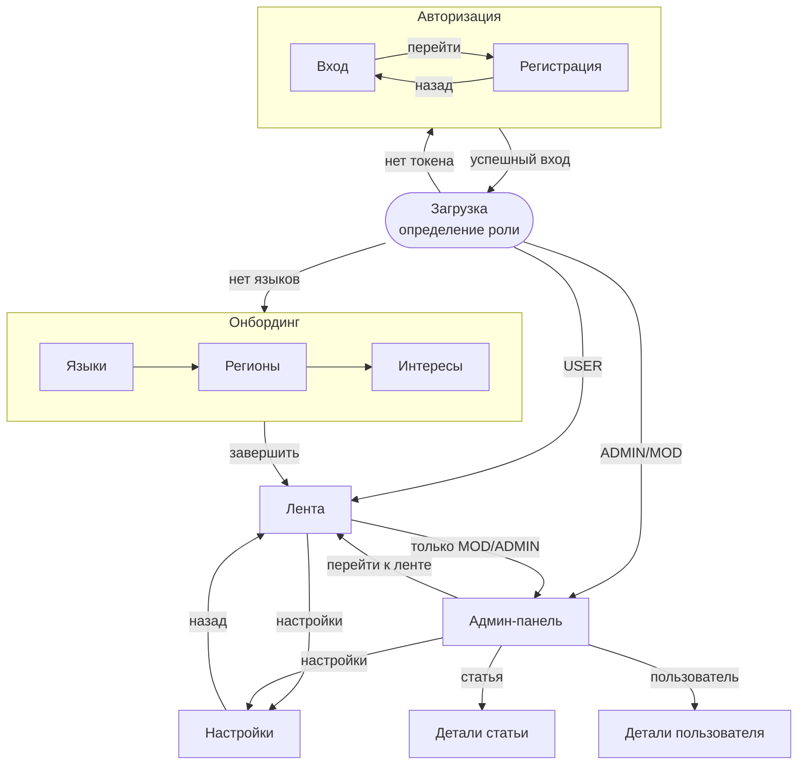

# Android-приложение NewsDove

## Экраны и навигация

---

## Экраны пользователя

### Вход (`LoginScreen`)

- Поля: логин и пароль (центрированный placeholder, кастомная граница)
- Кнопки: «Регистрация» (TextButton) и «Войти» (Button) в одной строке
- Ошибки входа отображаются под полями

### Регистрация (`RegisterScreen`)

- Поля: логин и пароль в карточке (`primaryContainer`)
- Кнопки: «Зарегистрироваться», «Уже есть аккаунт»

### Онбординг (3 шага)

Все три шага используют один `OnboardingViewModel` (shared по back stack `"onboarding"`).

1. **Языки** — выбор языков новостей (чипы)
2. **Регионы** — выбор регионов (чипы)
3. **Интересы** — выбор категорий интересов (чипы)

После завершения онбординга → `Home`. Если онбординг инициирован из Admin (пустые языки) → после завершения возвращается на `Home`, но Admin остаётся в back stack.

### Лента (`FeedScreen`)

- Список статей с курсорной пагинацией (`cursor`)
- Каждая карточка: заголовок, теги, `matchPercent` (процент совпадения), паблишер, дата
- Статья открывается в браузере по ссылке (`CustomTabsIntent`)
- Оценка: кнопки Лайк / Дизлайк
- Жалоба: диалог с выбором причины (`reasonCode`)
- Иконка настроек → `Settings`; иконка админ-панели (только для MOD/ADMIN) → `Admin`

**Формула `matchPercent`:** см. [docs/feed-score.md](feed-score.md)

### Настройки (`SettingsScreen`)

- Языки новостей (мультивыбор)
- Регионы (мультивыбор)
- Частота уведомлений (`notificationFrequency`)
- Смена пароля
- Выход из аккаунта

---

## Администраторская панель (`AdminPanelScreen`)

Доступна ролям `MODERATOR` и `ADMIN`.

### Вкладки

ADMIN видит 5 вкладок, MODERATOR — 2 (только Статьи и Жалобы). Источник: `AdminPanelScreen.kt:74–78`.

| Вкладка | Доступно | Описание |
|---------|----------|----------|
| Статьи | MOD + ADMIN | Список статей с фильтрами |
| Жалобы | MOD + ADMIN | Список жалоб с фильтрами |
| Пользователи | только ADMIN | Список пользователей с фильтрами |
| Аудит | только ADMIN | Журнал административных действий |
| Статистика | только ADMIN | Общая статистика системы |

### Жалобы (`ComplaintsTabContent`)

Поля фильтра (bottom sheet):
- Текстовый поиск
- Дата от / до (DatePicker)
- Причина жалобы, репортёр, язык

### Статьи (`ArticlesTabContent`)

Поля фильтра:
- Текстовый поиск
- Дата от / до (DatePicker)
- Скрытые/показаны (`hidden`), паблишер, язык, регион, категория, наличие жалоб, классифицированные

Действия на карточке:
- Перейти к деталям (`admin/article/{id}`)
- Скрыть / Показать статью (PUT `/admin/articles/{id}/hidden`)
- Сбросить жалобы (DELETE `/admin/articles/{id}/complaints`)

### Пользователи (`UsersTabContent`)

Поля фильтра: роль, язык, регион, наличие жалоб, дата регистрации от / до

Действия на карточке:
- Перейти к деталям (`admin/user/{id}`)
- Сменить роль пользователя

### Детали статьи (`AdminArticleDetailScreen`)

- Полная информация об статье: заголовок, теги с процентами, паблишер, язык, регион, дата
- Список жалоб на статью
- Скрыть / Показать; Сбросить жалобы

### Детали пользователя (`AdminUserDetailScreen`)

- Ник, роль, дата регистрации, языки, регионы
- Список жалоб пользователя
- Смена роли (только `ADMIN`)

---

## Технические детали Android

| Параметр | Значение |
|----------|----------|
| compileSdk / targetSdk | 37 |
| minSdk | 26 (Android 8.0) |
| applicationId | `org.example.androidapp` |
| BASE\_URL по умолчанию | `https://10.0.2.2:8443` (эмулятор) |
| Хранение токенов | `EncryptedSharedPreferences` / DataStore + Android Keystore |
| HTTP-клиент | OkHttp 5.5.1 (через Ktor клиент) |
| Навигация | Navigation Compose 2.10.2 |
| Состояние | `StateFlow` + `collectAsStateWithLifecycle` |
