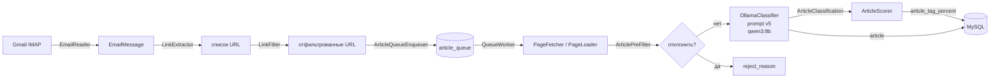
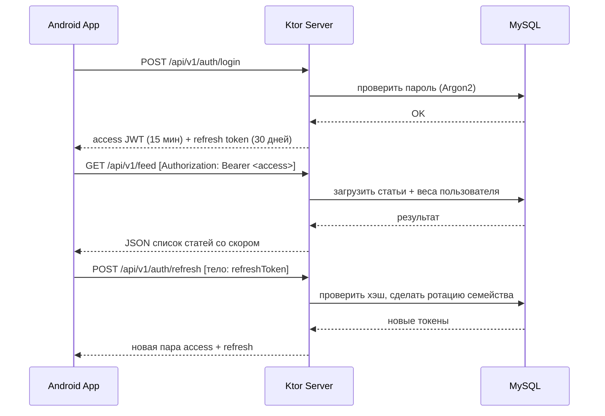
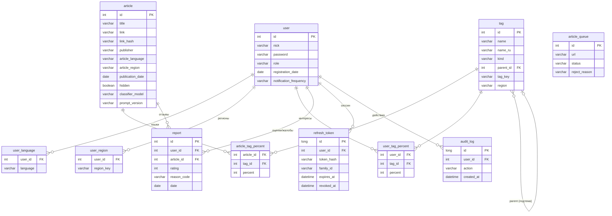

# Архитектура NewsDove

## Схема модулей

```mermaid
graph TD
    shared["`:shared`<br/>DTO (kotlinx.serialization)"]
    core["`:core`<br/>Java: сущности, сервисы, пайплайн, ИИ"]
    server["`:server`<br/>Kotlin: Ktor REST API"]
    android["`:androidApp`<br/>Kotlin: Jetpack Compose"]
    db[(MySQL)]
    ollama[Ollama qwen3:8b]
    gmail[Gmail IMAP]

    core --> shared
    server --> shared
    server --> core
    android --> shared
    core --> db
    server --> db
    core --> ollama
    core --> gmail
    android -->|HTTPS| server
```

---

## Поток данных — пайплайн

Пайплайн запускается по расписанию (`:core:run --args="--process-queue N"`) или через `EmailScheduler`.



**Важно:** текст статьи **не сохраняется**. В базе хранятся только:
- `title`, `link`, `link_hash`
- `publisher`, `article_language`, `article_region`, `publication_date`
- `classifier_model`, `prompt_version`, `hidden`
- теги и их веса (`article_tag_percent`)

---

## Поток аутентификации и запросов



---

## ER-диаграмма (основные таблицы)



---

## Список миграций Flyway

Всего 34 миграции: 25 SQL-файлов (`core/src/main/resources/db/migration/`) + 9 Java-классов (`core/src/main/java/db/migration/`).

| Версия | Тип | Описание |
|--------|-----|----------|
| V1 | SQL | Базовая схема (baseline) |
| V1\_1 | SQL | Дедупликация ссылок |
| V1\_2 | SQL | Нормализация регионов |
| V1\_3 | SQL | Нормализация языков |
| V2 | SQL | Суррогатный ключ пользователя |
| V3\_1 | SQL | Управление паролями (история) |
| V3\_2 | Java | Хеширование паролей Argon2id |
| V3\_3 | SQL | Удаление первого пароля |
| V4 | SQL | Роль пользователя (ENUM) |
| V5\_1 | SQL | Схема таксономии тегов |
| V5\_2 | Java | Генерация ключей тегов |
| V5\_3 | SQL | Ограничения таксономии |
| V5\_4 | Java | Заполнение таксономии (seed) |
| V6\_1 | Java | Языки и регионы пользователя |
| V6\_2 | SQL | Удаление устаревших колонок |
| V7\_1 | SQL | Схема очереди статей |
| V7\_2 | Java | Заполнение очереди статей |
| V8\_1 | SQL | Новые колонки статьи |
| V8\_2 | Java | Заполнение метаданных статей |
| V8\_3 | SQL | Ограничения метаданных статьи |
| V9\_1 | Java | Проверка причин жалоб |
| V9\_2 | SQL | Код причины жалобы |
| V10\_1 | SQL | Блокировка пользователя |
| V10\_2 | SQL | Refresh-токены |
| V10\_3 | SQL | Журнал аудита |
| V11\_1 | SQL | Схема сущностей (KnownEntity) |
| V11\_2 | Java | Заполнение сущностей (seed) |
| V12\_1 | SQL | Причины отклонения в PreFilter |
| V12\_2 | SQL | Причина отклонения newsletter-хостов |
| V12\_3 | SQL | Поле `hidden` у статьи |
| V13\_1 | SQL | Русское название тега (`name_ru`) |
| V13\_2 | Java | Заполнение русских названий тегов |
| V13\_3 | SQL | Причина отклонения dw-section-page |
| V14\_1 | SQL | Русское название региона |
